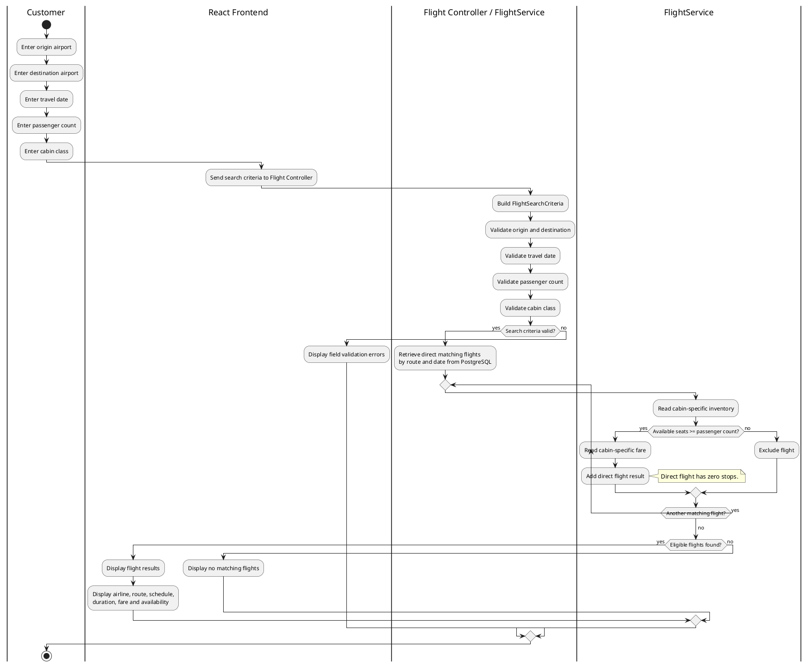

# Activity Diagram — Flight Search

## PlantUML Activity Diagram

## Workflow Explanation

The Customer supplies the five approved search fields. The frontend forwards them to the backend, where `FlightSearchCriteria` and `FlightService` validate and query direct flights. Each matching flight is checked against cabin-specific inventory and fare records. Flights with insufficient availability are omitted, and direct flights are presented with zero stops.

## Important Business Rules and Decision Points

- Origin and destination must be distinct valid airports.
- Passenger count must be positive.
- Travel date must pass backend future-date validation.
- Cabin class must be supported.
- Only direct, one-way flights are returned.
- A result requires enough available seats in the selected cabin for the passenger count.
- Valid search criteria with no matches return an empty result rather than an application failure.

## Unresolved Assumptions

- The exact future travel-date boundary is still open.
- Exact supported cabin-class values remain open.
- Response-time targets for interactive search remain open.

## Consistency Verification

This activity follows the flight-search sequence and SRS requirements FR-FLIGHT-001 through FR-FLIGHT-010. It does not include external airline/GDS or connecting-flight behavior.
