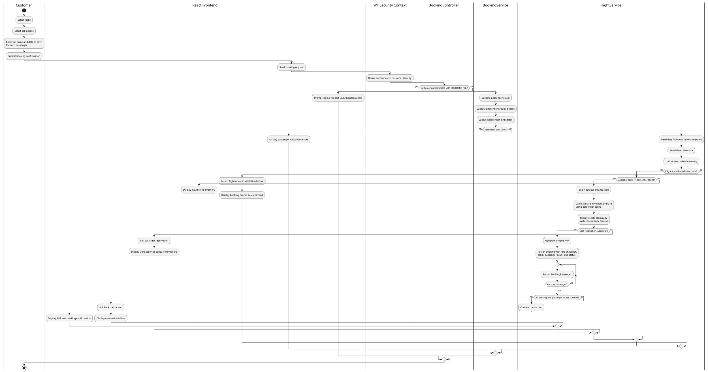

# Activity Diagram — Flight Booking

## PlantUML Activity Diagram

## Workflow Explanation

The Customer selects a flight and cabin, enters passenger details and confirms the booking. Authentication is verified first, followed by passenger validation. `FlightService` revalidates flight, fare and cabin availability before `BookingService` starts a transaction. The backend calculates fare and reserves seats; successful execution persists the booking and passenger records before generating/returning a unique PNR.

## Important Business Rules and Decision Points

- Passenger count must equal the number of passenger records.
- Full name and date of birth are mandatory for every passenger.
- The client-supplied fare is never trusted.
- Available seats must not become negative.
- Booking creation and seat reservation are transactional.
- Database concurrency protection prevents overselling.
- Failed persistence rolls back booking, passenger and inventory changes.
- Cancellation and payment behaviors are not triggered by the booking workflow.

## Unresolved Assumptions

- PNR format and uniqueness generation strategy are open.
- Supported cabin-class values are open.
- Fare precision and rounding rules are open.
- Passenger-name/date validation limits beyond mandatory fields are open.

## Consistency Verification

This activity matches the booking sequence and SRS requirements FR-SELECT-004 through FR-BOOKING-015. It contains no payment, seat-map or rescheduling behavior.
