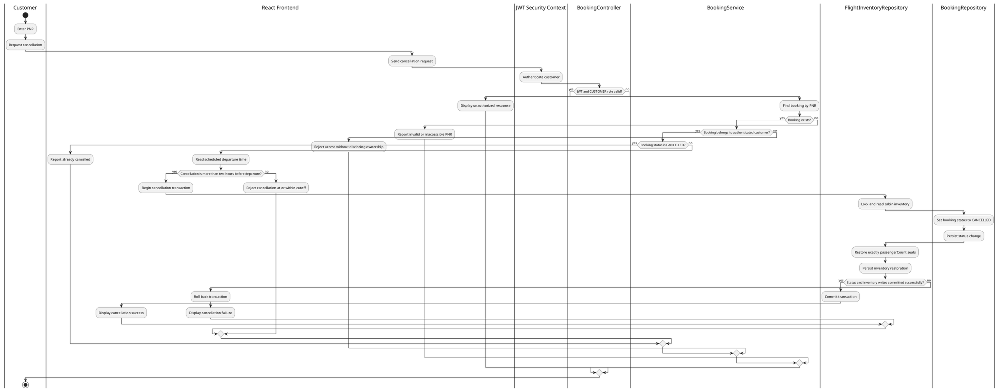

# Activity Diagram — Booking Cancellation

## PlantUML Activity Diagram

## Workflow Explanation

The Customer submits a PNR. Authentication is checked by the JWT security context, then `BookingService` verifies whether the PNR exists and belongs to the authenticated Customer. It rejects cancelled and cutoff-ineligible bookings before starting a transaction. An eligible cancellation changes status to `CANCELLED` and restores the cabin seats by the booking's passenger count. Status and inventory changes commit or roll back together.

## Important Business Rules and Decision Points

- The booking must belong to the authenticated customer.
- Unknown and unauthorized PNRs do not disclose unrelated ownership.
- Already-cancelled bookings cannot be cancelled again.
- Cancellation is allowed only more than two hours before departure.
- Successful cancellation restores inventory exactly once.
- Cancellation and inventory restoration execute transactionally.
- Cancelled bookings remain retrievable with `CANCELLED` status.

## Unresolved Assumptions

- Departure timezone and exact cutoff comparison behavior remain open.
- The system response format for invalid PNR and repeated cancellation remains open.

## Consistency Verification

This activity follows the cancellation sequence and SRS requirements FR-MGMT-001 through FR-MGMT-012 and BR-CANCEL-01 through BR-CANCEL-05. It excludes rescheduling, refunds and partial passenger cancellation.
