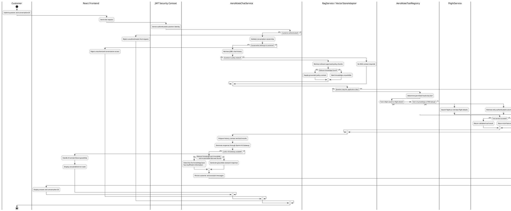

# Activity Diagram — AeroMate AI Interaction

## PlantUML Activity Diagram

## Workflow Explanation

The Customer submits a question with a conversation identifier. The chat service verifies authentication and conversation ownership, retrieves persisted JDBC history and decides whether RAG or a permitted read-only tool is needed. Policy retrieval uses approved knowledge chunks; application data is delegated to existing flight or booking services. The LLM returns a grounded response, which is persisted with the conversation history.

## Important Business Rules and Decision Points

- Conversation ownership must match the authenticated user.
- LLM-supplied user identity is never trusted.
- RAG is used only for policy or knowledge-grounded questions.
- Unavailable knowledge causes an insufficient-information acknowledgment instead of invented policy.
- Permitted tools are read-only: flight search, flight details, own bookings and accessible PNR lookup.
- AeroMate cannot create/cancel bookings, process payments or modify fares/inventory.
- Tool failures are handled without bypassing normal authorization.
- Conversation history remains separated from policy-vector data.

## Unresolved Assumptions

- Conversation-ID generation/format remains open.
- pgvector fallback choice remains open.
- MCP transport remains open and is not part of this normal chat workflow.
- Whether RAG source citations are mandatory remains open.
- Maximum memory/history retention remains open.

## Consistency Verification

This activity follows the AeroMate chat sequence and SRS FR-AI-001 through FR-AI-021. MCP is kept as a separate read-only flight interoperability demonstration, consistent with FR-AI-022 through FR-AI-025.
