# SkyBook — UML Class Diagram

**Status:** Draft — pending review

## Mermaid Class Diagram

```mermaid
classDiagram
    direction LR

    class User {
        <<entity>>
        -Long id
        -String email
        -String passwordHash
        -String fullName
        -UserRole role
        -LocalDateTime createdAt
        +getId() Long
        +getEmail() String
        +getRole() UserRole
    }

    class UserRole {
        <<enumeration>>
        CUSTOMER
        ADMIN
    }

    class Airport {
        <<entity>>
        -Long id
        -String code
        -String name
        -String city
        -String country
        +getId() Long
        +updateDetails(name, city, country) void
    }

    class Flight {
        <<entity>>
        -Long id
        -String airlineName
        -String airlineCode
        -String flightNumber
        -Airport origin
        -Airport destination
        -LocalDateTime departureTime
        -LocalDateTime arrivalTime
        -FlightStatus status
        +getDurationMinutes() int
        +getStops() int
        +isDirect() boolean
    }

    class FlightStatus {
        <<enumeration>>
        SCHEDULED
        UPDATED
        CANCELLED
    }

    class FlightInventory {
        <<entity>>
        -Long id
        -CabinClass cabinClass
        -int totalSeats
        -int availableSeats
        +hasAvailability(passengerCount) boolean
        +reserveSeats(passengerCount) void
        +restoreSeats(passengerCount) void
    }

    class FlightFare {
        <<entity>>
        -Long id
        -CabinClass cabinClass
        -BigDecimal amount
        +getAmount() BigDecimal
    }

    class CabinClass {
        <<enumeration>>
        ECONOMY
        BUSINESS
    }

    class FlightSearchCriteria {
        <<value object>>
        -Airport origin
        -Airport destination
        -LocalDate travelDate
        -int passengerCount
        -CabinClass cabinClass
        +validate() void
    }

    class FlightSearchResult {
        <<DTO>>
        -Flight flight
        -CabinClass cabinClass
        -int availableSeats
        -BigDecimal fare
        -int stops
    }

    class Booking {
        <<entity>>
        -Long id
        -String pnr
        -User customer
        -Flight flight
        -CabinClass cabinClass
        -int passengerCount
        -BigDecimal fareSnapshot
        -BookingStatus status
        -LocalDateTime createdAt
        -LocalDateTime updatedAt
        +getCustomerId() Long
        +isOwnedBy(userId) boolean
        +canBeCancelled(departureTime) boolean
        +cancel() void
    }

    class BookingStatus {
        <<enumeration>>
        CONFIRMED
        CANCELLED
    }

    class BookingPassenger {
        <<entity>>
        -Long id
        -Booking booking
        -String fullName
        -LocalDate birthDate
    }

    class AuthService {
        <<service>>
        +register(request) User
        +login(email, password) String
        +getAuthenticatedUser() User
    }

    class JwtAuthenticationService {
        <<security>>
        +generateToken(User) String
        +validateToken(token) boolean
        +getSubject(token) String
    }

    class FlightService {
        <<service>>
        +search(criteria) List~FlightSearchResult~
        +getFlightDetails(flightId) Flight
        +validateSelection(flightId, cabin, count) Flight
    }

    class BookingService {
        <<service>>
        +createBooking(userId, request) Booking
        +getMyBookings(userId) List~Booking~
        +getBookingByPnr(userId, pnr) Booking
        +cancelBooking(userId, pnr) Booking
        -calculateFare(flight, cabin, count) BigDecimal
        -reserveSeats(flight, cabin, count) void
    }

    class AdminService {
        <<service>>
        +createAirport(request) Airport
        +updateAirport(id, request) Airport
        +createFlight(request) Flight
        +updateFlight(id, request) Flight
        +updateFare(flightId, cabin, fare) FlightFare
        +updateInventory(flightId, cabin, inventory) FlightInventory
        +getAllBookings() List~Booking~
    }

    class Conversation {
        <<entity>>
        -Long id
        -String conversationId
        -Long ownerUserId
        -LocalDateTime createdAt
        -LocalDateTime updatedAt
        +isOwnedBy(userId) boolean
    }

    class ChatMessage {
        <<JDBC chat memory>>
        -String conversationId
        -String role
        -String content
        -LocalDateTime createdAt
    }

    class AeroMateChatService {
        <<service>>
        +chat(conversationId, message) ChatResponse
        -validateConversationOwner(conversationId, userId) void
    }

    class RagService {
        <<service>>
        +ingestApprovedDocuments() void
        +retrieveRelevantContext(query) List~PolicyChunk~
    }

    class PolicyDocument {
        <<document>>
        -String title
        -String source
        -String content
    }

    class PolicyChunk {
        <<value object>>
        -String documentTitle
        -String content
        -float[] embedding
    }

    class VectorStoreAdapter {
        <<infrastructure>>
        +store(chunk) void
        +similaritySearch(query, limit) List~PolicyChunk~
    }

    class AeroMateToolRegistry {
        <<Spring AI tools>>
        +searchFlights(criteria) List~FlightSearchResult~
        +getFlightDetails(flightId) Flight
        +getMyBookings() List~Booking~
        +getBookingDetails(pnr) Booking
    }

    class McpServer {
        <<MCP server>>
        +exposeReadOnlyFlightTools() void
    }

    class McpClient {
        <<MCP client>>
        +discoverTools() List~String~
        +invokeFlightSearch(criteria) List~FlightSearchResult~
        +invokeFlightDetails(flightId) Flight
    }

    class PnrGenerator {
        <<domain utility>>
        +generateUniquePnr() String
    }

    User "1" --> "2" UserRole : role
    Flight "1" --> "1" FlightStatus : status
    Booking "1" --> "1" BookingStatus : status
    Booking "1" --> "1" CabinClass : cabinClass
    FlightInventory "1" --> "1" CabinClass : cabinClass
    FlightFare "1" --> "1" CabinClass

    Airport "1" <-- "0..*" Flight : origin
    Airport "1" <-- "0..*" Flight : destination
    Flight "1" *-- "1..*" FlightInventory : inventory
    Flight "1" *-- "1..*" FlightFare : fares

    User "1" --> "0..*" Booking : owns
    Flight "1" --> "0..*" Booking : booked for
    Booking "1" *-- "1..*" BookingPassenger : contains

    User "1" --> "0..*" Conversation : owns
    Conversation "1" *-- "0..*" ChatMessage : stores

    AuthService --> JwtAuthenticationService : uses
    AuthService --> User : manages
    JwtAuthenticationService --> User : authenticates

    FlightService --> FlightSearchCriteria : receives
    FlightService --> FlightSearchResult : returns
    FlightService --> Flight : searches
    FlightService --> FlightInventory : validates
    FlightService --> FlightFare : reads

    BookingService --> Booking : creates and manages
    BookingService --> BookingPassenger : validates and creates
    BookingService --> FlightService : validates availability and fare
    BookingService --> PnrGenerator : generates PNR

    AdminService --> Airport : manages
    AdminService --> Flight : manages
    AdminService --> FlightFare : manages
    AdminService --> FlightInventory : manages
    AdminService --> Booking : views

    AeroMateChatService --> Conversation : owns and validates
    AeroMateChatService --> ChatMessage : reads and appends
    AeroMateChatService --> RagService : retrieves context
    AeroMateChatService --> AeroMateToolRegistry : invokes tools

    RagService --> PolicyDocument : ingests
    RagService --> PolicyChunk : creates and retrieves
    RagService --> VectorStoreAdapter : stores and searches
    PolicyDocument "1" *-- "1..*" PolicyChunk : produces

    AeroMateToolRegistry --> FlightService : delegates search and details
    AeroMateToolRegistry --> BookingService : delegates owned booking retrieval

    McpServer --> AeroMateToolRegistry : exposes read-only flight tools
    McpClient --> McpServer : discovers and invokes
    McpClient --> FlightService : receives flight operations
```

## Major Classes and Relationships

- **User** represents CUSTOMER and ADMIN accounts. Role values are server-controlled and stored as part of the account.
- **Airport** is the origin or destination entity used by one or more flights. Airport code is expected to be unique.
- **Flight** belongs to one origin airport and one destination airport. It aggregates flight inventory and fare records by cabin class.
- **FlightInventory** and **FlightFare** are separate one-per-cabin records associated with a flight. Both use cabin-class keys to prevent ambiguity.
- **Booking** is owned by a **User** and associated with one **Flight**. It stores cabin class and a fare snapshot so later history and cancellation do not depend on current fare changes.
- **BookingPassenger** is the explicit entity representing passengers associated with a booking. It is composition-owned by Booking.
- **FlightService**, **BookingService** and **AdminService** keep domain logic in the service layer and support the modular monolith design.
- **AuthService** and **JwtAuthenticationService** provide registration, login, role determination and authenticated-user context.
- **Conversation** stores server-side ownership metadata. **ChatMessage** represents Spring AI JDBC-managed message records associated with a conversation identifier.
- **RagService**, **PolicyDocument**, **PolicyChunk** and **VectorStoreAdapter** represent the RAG pipeline and vector retrieval boundary.
- **AeroMateToolRegistry** exposes only the approved read-only flight and booking tools and delegates to existing services.
- **McpServer** and **McpClient** demonstrate a small read-only flight MCP integration. They do not expose booking or administrative mutations.

## Relationship Interpretation

- **Composition** is used where passenger records belong to a booking, a flight aggregates cabin-specific inventory/fare records, and conversation history belongs to conversation metadata.
- **Aggregation/association** is used for flights referencing airports and bookings referencing users/flights.
- **Dependencies** show that services use repositories, domain utilities and Spring AI components without exposing entities through API DTO boundaries.
- Multiplicity requires at least one passenger per booking and one inventory/fare record for supported cabin classes. Exact supported cabin-count multiplicity remains an implementation decision.

## Design Assumptions

1. Supported cabin-class values for MVP are fixed to ECONOMY and BUSINESS.
2. PNR generation format and conversation-ID format are not fixed by the proposal or SRS.
3. Spring AI JDBC chat-message storage details are represented as a conceptual class rather than the framework's internal implementation.
4. MCP transport and Spring AI dependency versions may vary with environment compatibility.
5. A flight can have fare and inventory records for one or more cabin classes, but the minimum set is not specified.
6. JWT access-token expiry is fixed at 60 minutes for MVP, and refresh-token behavior is out of scope.
7. Registration password policy requires at least 8 characters with uppercase, lowercase, digit and special character constraints.

## Consistency Verification

- The five functional modules in the proposal and SRS are represented by Flight, Booking, BookingPassenger, Admin and service classes.
- The diagram includes direct flight search, cabin-class selection, backend fare validation, transactional seat reservation and PNR retrieval.
- Booking ownership and conversation ownership are explicit.
- RAG, Tool Calling, JDBC Chat Memory and MCP are separated while remaining inside the modular AI package.
- Monetary values use `BigDecimal`, and seat inventory is represented by cabin class.
- No real payment, airline/GDS, seat map, rescheduling, partial-cancellation, deletion or microservice design is introduced.
- The AI classes expose no booking, cancellation, payment, fare-change or inventory-change operations.

## Unresolved Design Decisions

- PNR format and uniqueness strategy
- Exact conversation-ID ownership and generation strategy
- Exact PostgreSQL pgvector versus compatible fallback integration
- Supported MCP transport
- Fare precision and rounding
- Passenger-validation policy details beyond mandatory presence and valid date format
