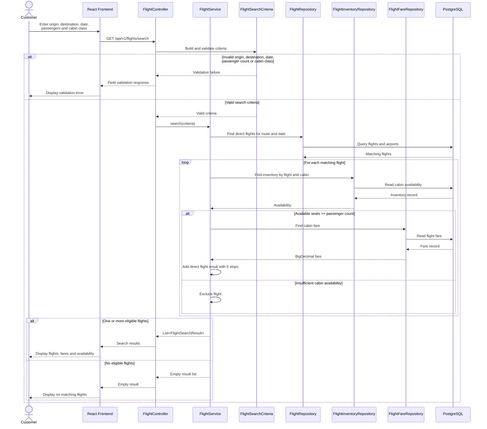

# Sequence Diagram — Flight Search

## Mermaid Sequence Diagram

## Workflow Explanation

The Customer submits validated frontend search fields to the flight search controller. The backend constructs a `FlightSearchCriteria` value and rejects invalid combinations before querying the database. `FlightService` retrieves direct flights and independently checks cabin inventory and fare records. Flights with insufficient seat availability are omitted, and valid direct flights are identified with zero stops. The frontend displays loading, populated, empty or validation/error states without introducing the workflow through an external airline system.

## Consistency and Assumptions

- Uses the approved `/api/v1/flights/search` operation.
- Applies only direct, one-way flights from PostgreSQL.
- No real airline/GDS search occurs.
- The exact future-date boundary remains an open SRS question.
- Monetary fare values are represented with `BigDecimal` semantics.
