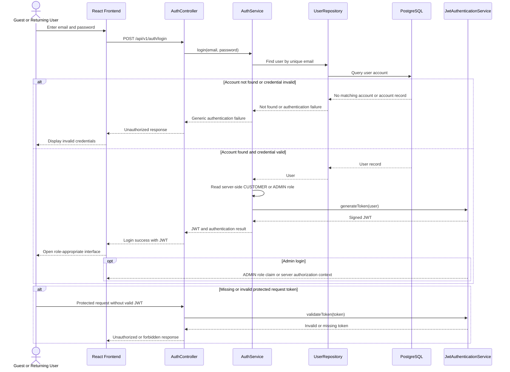

# Sequence Diagram — User Authentication

## Mermaid Sequence Diagram

## Workflow Explanation

The frontend submits login credentials to the authentication controller. `AuthService` retrieves the account through the repository and validates the password. Invalid credentials produce a generic authentication response so the system does not disclose account existence. A successful login creates a JWT containing server-controlled identity and role information. Protected requests validate the JWT and enforce CUSTOMER or ADMIN authorization.

## Consistency and Assumptions

- Uses the approved `/api/v1/auth/login` operation.
- Registration follows the same server-side account and unique-email rules but is not part of this login sequence.
- Password policy, JWT expiry, refresh tokens and logout behavior remain unresolved in the SRS.
- No client-supplied role or identity is trusted.
