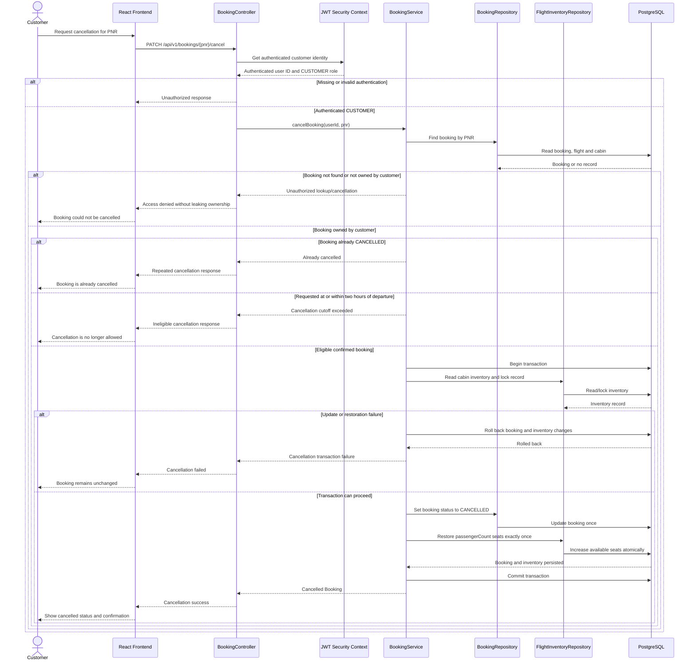

# Sequence Diagram — Booking Cancellation

## Mermaid Sequence Diagram

## Workflow Explanation

Cancellation is processed by PNR through `BookingService`. The service derives customer identity from security context, verifies booking ownership, detects repeated cancellation and evaluates the two-hour departure cutoff. For an eligible booking, status update and cabin-seat restoration execute as one transaction. If any persistence step fails, both changes roll back. Repeated and cutoff-ineligible attempts never restore inventory.

## Consistency and Assumptions

- Uses the approved `/api/v1/bookings/{pnr}/cancel` operation.
- Booking remains retrievable with `CANCELLED` status after successful cancellation.
- Cutoff timezone interpretation remains an SRS open question.
- Inventory restoration uses the booking's passenger count, cabin class and fare snapshot relationship.
