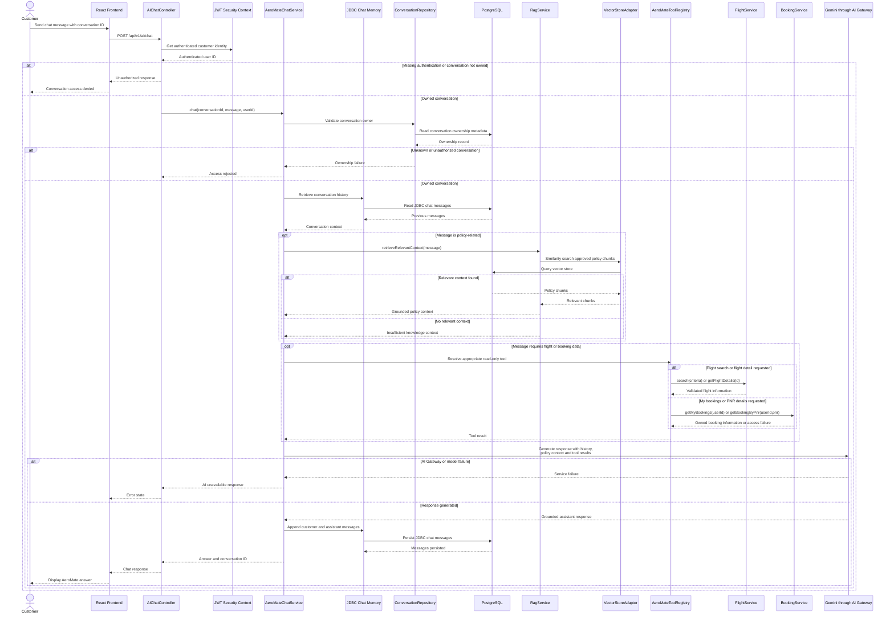

# Sequence Diagram — AeroMate AI Chat

## Mermaid Sequence Diagram

## Workflow Explanation

A customer sends an authenticated chat request. `AeroMateChatService` validates server-maintained conversation ownership and retrieves JDBC chat history. Policy-related questions optionally invoke RAG and vector retrieval. Application-data questions invoke only the approved read-only Tool Registry, with customer identity supplied by the security context. The LLM receives conversation history, relevant context and tool results, then returns the answer. Successful exchanges are persisted to JDBC chat memory.

AeroMate tools do not create or cancel bookings or change fares or inventory. If policy retrieval has no relevant information, the response acknowledges insufficient knowledge rather than inventing an answer.

## Consistency and Assumptions

- Uses the approved `/api/v1/ai/chat` operation.
- Conversation ownership metadata is separate from framework-managed messages.
- MCP is a separate interoperability demonstration and is not required in this normal chat sequence.
- pgvector is preferred, with a compatible fallback permitted if unavailable.
- Conversation-ID generation and exact MCP transport remain open decisions.
