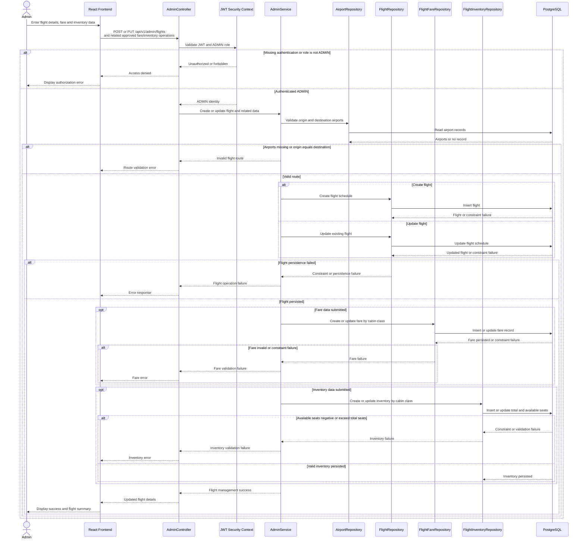

# Sequence Diagram — Admin Flight Management

## Mermaid Sequence Diagram

## Workflow Explanation

The Admin submits flight management data through the authorized admin interface. The controller verifies JWT authentication and the ADMIN role before delegating to `AdminService`. The service validates existing origin and destination airports and requires them to differ. It then creates or updates the flight record and optionally creates or updates cabin-specific fares and inventory. Both inventory and fare operations enforce unique flight-and-cabin combinations and prevent invalid seat bounds.

The MVP does not define operational deletion of airport or flight records, so no delete workflow is represented.

## Consistency and Assumptions

- Covers approved create/update flight operations and cabin fare/inventory operations.
- Administrative endpoints require the ADMIN role.
- Exact supported cabin values remain open.
- Fare precision and rounding remain open.
- Flight, fare and inventory persistence details may require implementation-time transactions, but no more complex workflow is assumed.
