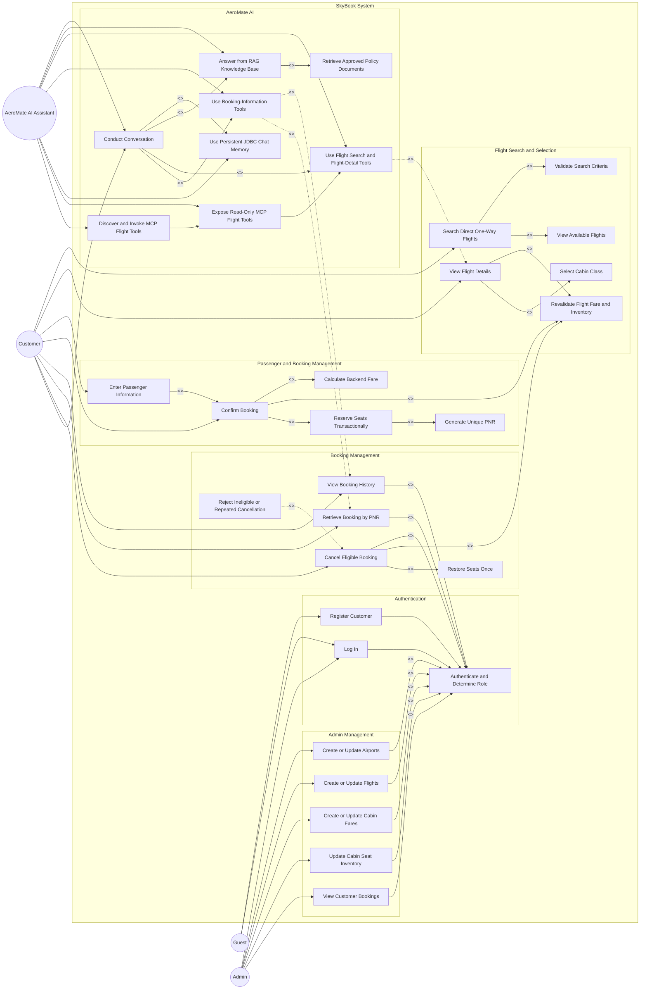

# SkyBook — Use-Case Diagram

## Scope

This diagram represents the MVP use cases defined by the approved SkyBook project proposal and Software Requirements Specification. It covers customer booking operations, administrative management, authentication, and AeroMate's four agreed Spring AI capabilities.

## Mermaid Use-Case Diagram

## Actors

- **Guest:** An unauthenticated person who may register a customer account or log in.
- **Customer:** An authenticated user who searches and selects flights, enters passengers, confirms and manages bookings, retrieves PNR details, cancels eligible bookings, and communicates with AeroMate.
- **Admin:** An authenticated user with the ADMIN role who manages airports, flight schedules, cabin fares and inventory, and views customer bookings.
- **AeroMate AI Assistant:** The Spring AI assistant that uses approved policy documents, read-only application tools, persistent JDBC chat memory and a minimal MCP demonstration.

## Major Use Cases

### 1. Flight Search and Selection

- The Customer submits origin, destination, travel date, passenger count and cabin class.
- The system validates the criteria and returns only direct, one-way flights with sufficient cabin inventory.
- Flight selection includes cabin selection and backend revalidation of the flight, fare and inventory.

### 2. Passenger and Booking Management

- The Customer enters passenger full names and dates of birth.
- Booking confirmation validates inventory and passenger data, calculates the fare from backend records and reserves seats transactionally.
- A successful booking generates a unique PNR and persists the passengers, fare snapshot and booking status.

### 3. Booking Management

- The Customer can view their own booking history and retrieve an owned booking by PNR.
- Cancellation is allowed only more than two hours before scheduled departure.
- Successful cancellation changes the booking to `CANCELLED` and restores the cabin inventory once. Repeated and cutoff-expired cancellations are rejected.

### 4. Admin Management

- The Admin creates or updates airports and flight schedules.
- The Admin creates or updates cabin fares and inventory and may view customer bookings.
- The MVP does not include operational deletion of airports or flights.

### 5. AeroMate and AI Capabilities

- **RAG:** Approved Markdown policy documents are loaded, transformed, embedded and retrieved to support grounded airline-policy answers.
- **Tool calling:** `searchFlights`, `getFlightDetails`, `getMyBookings` and `getBookingDetails` are read-only tools that reuse application services and server-side identity and authorization.
- **JDBC Chat Memory:** Conversation context is persisted with PostgreSQL and associated with the authenticated user's conversation ownership metadata.
- **MCP:** A minimal MCP client-server demonstration exposes only read-only flight search and flight-detail capabilities.

AeroMate does not confirm bookings, cancel bookings, process payments or modify fares or inventory. Such mutations belong to the normal authenticated application workflows.

## Include and Extend Relationships

- **Include** relationships represent mandatory steps: authentication for protected operations, search validation, fare calculation, inventory revalidation, seat reservation and PNR generation.
- **Extend** relationships represent alternative paths: repeated or cutoff-expired cancellation rejection and insufficient-inventory handling during booking confirmation.
- Tool-use relationships are modeled as optional extensions of normal application retrieval use cases because the tools may be used only when a conversation requires application data.

## Consistency Review

- The five functional modules and all four AeroMate capabilities are represented.
- The use cases do not include connecting/multi-stop flights, real payments, real airline/GDS integration, rescheduling, partial cancellation, deletion of airports or flights, or administrative AI mutations.
- Customer PNR and conversation access is ownership-protected.
- Admin operations require the ADMIN role.
- The diagram follows the direct, one-way, transactional-MVP scope in both source documents.
