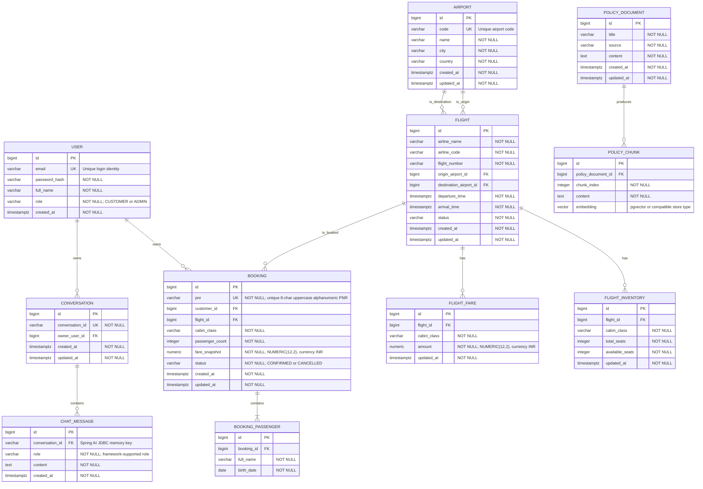

# SkyBook — Entity Relationship Diagram (ERD)

**Status:** Ready for Review

## Scope

This ERD describes the PostgreSQL persistence model required by the approved SkyBook MVP proposal and SRS. It excludes real airline/GDS integration, payments, seat maps, rescheduling, partial cancellation, and operational record deletion.

## Mermaid ER Diagram

## Entity Descriptions

### USER

Stores customer and administrator accounts. The `role` column represents server-controlled authorization and is constrained to `CUSTOMER` or `ADMIN`. `email` is unique and used for login.

### AIRPORT

Stores airport code, name, city and country. Airport code is unique. A flight has separate foreign keys for origin and destination, which is why each airport can participate in many outgoing and incoming flights.

### FLIGHT

Stores airline name and airline code directly, as approved by the MVP domain model. It also stores flight number, origin and destination airports, schedule, and status. An airline entity is not required because the proposal does not require independent airline master data.

### FLIGHT_INVENTORY

Stores one record per flight and cabin class. It holds both total and available seats. The `(flight_id, cabin_class)` combination is unique.

### FLIGHT_FARE

Stores one monetary fare per flight and cabin class. The `(flight_id, cabin_class)` combination is unique. Monetary values use an exact PostgreSQL `NUMERIC/DECIMAL` type rather than floating-point values.

### CABIN_CLASS

Cabin class is represented by constrained application values rather than a separate master entity in the MVP. This keeps the model simple and aligns with the cabin uniqueness requirement. Approved MVP values are `ECONOMY` and `BUSINESS`.

### BOOKING

Stores the customer owner, flight, cabin class, passenger count, fare snapshot, PNR, status and timestamps. The fare snapshot and cabin class preserve the values needed for history and cancellation inventory restoration even if current fares or schedules later change.

### BOOKING_PASSENGER

Stores passenger identity details for a specific booking. It preserves full name and date of birth for that booking and prevents passenger details from being reused or inferred across bookings.

### CONVERSATION

Stores server-side conversation ownership metadata separately from Spring AI's framework-managed message persistence. `conversation_id` is unique, and `owner_user_id` identifies the authenticated user.

### CHAT_MESSAGE

Represents persistent JDBC chat-memory message records. Spring AI JDBC Chat Memory must use the official schema initialization supported by the selected Spring AI version; implementation-specific mapping details are documented separately. The key database requirement here is association between conversation identifiers and ordered messages with ownership validation through `CONVERSATION`.

### POLICY_DOCUMENT

Stores the source and content of an approved Markdown airline-policy document. It is the ingestion-level source for RAG.

### POLICY_CHUNK

Stores transformed policy text chunks and their vector embedding. `policy_document_id` preserves source provenance. pgvector integration should remain compatible with the selected embedding model, and final embedding dimensions are confirmed during AI implementation without blocking ERD readiness.

## Primary and Foreign Keys

| Entity | Primary key | Foreign keys |
|---|---|---|
| USER | `id` | None |
| AIRPORT | `id` | None |
| FLIGHT | `id` | `origin_airport_id`, `destination_airport_id` |
| FLIGHT_INVENTORY | `id` | `flight_id` |
| FLIGHT_FARE | `id` | `flight_id` |
| BOOKING | `id` | `customer_id`, `flight_id` |
| BOOKING_PASSENGER | `id` | `booking_id` |
| CONVERSATION | `id` | `owner_user_id` |
| CHAT_MESSAGE | `id` | `conversation_id` conceptually |
| POLICY_DOCUMENT | `id` | None |
| POLICY_CHUNK | `id` | `policy_document_id` |

## Relationship Cardinalities

- **USER to BOOKING:** 1 to 0..*; each booking has exactly one customer.
- **USER to CONVERSATION:** 1 to 0..*; every conversation has exactly one owner.
- **AIRPORT to FLIGHT:** 1 origin airport to 0..* flights and 1 destination airport to 0..* flights.
- **FLIGHT to FLIGHT_INVENTORY:** 1 to 0..* cabin inventory records.
- **FLIGHT to FLIGHT_FARE:** 1 to 0..* cabin fare records.
- **FLIGHT to BOOKING:** 1 to 0..* bookings.
- **BOOKING to BOOKING_PASSENGER:** 1 to 1..* passengers.
- **CONVERSATION to CHAT_MESSAGE:** 1 to 0..* messages.
- **POLICY_DOCUMENT to POLICY_CHUNK:** 1 to 1..* chunks.

There is no direct many-to-many passenger/entity relationship. `BOOKING_PASSENGER` is the dedicated booking-to-passenger relationship that preserves passenger details for only that booking.

## Important Constraints

### General

- User email is unique and not null.
- Airport code is unique and not null.
- PNR is unique, not null, and stored as an 8-character uppercase alphanumeric identifier.
- Flight origin and destination airport IDs must differ.
- Cabin class values are constrained to `ECONOMY` and `BUSINESS` for MVP.
- All booking and cancellation timestamps are persisted consistently.

### User

- `role` must be `CUSTOMER` or `ADMIN`.
- Password storage must contain a one-way hash; the plaintext password is not stored.

### Flight

- `origin_airport_id <> destination_airport_id`.
- Departure and arrival times must both be present.
- Arrival time should be later than departure time.
- Status must use approved application values.

### Fare and Inventory

- `UNIQUE (flight_id, cabin_class)` on fare and inventory tables.
- Fare amount (`NUMERIC(12,2)`, INR) must be greater than or equal to zero.
- `total_seats >= 0`.
- `available_seats >= 0`.
- `available_seats <= total_seats`.

### Booking

- `passenger_count >= 1`.
- `fare_snapshot` (`NUMERIC(12,2)`, INR) is greater than or equal to zero.
- `status` must be `CONFIRMED` or `CANCELLED`.
- Passenger count should match the number of associated `BOOKING_PASSENGER` rows.
- Cabin class is retained in the booking.
- A booking must reference one existing customer and one existing flight.
- PNR generation uses collision retry on uniqueness conflicts.

### Booking Passenger

- Full name and birth date are not null.
- Every booking passenger must belong to exactly one booking.
- Passenger deletion is not independently supported; passenger records are owned by the booking.

### Conversation

- `conversation_id` is unique.
- `owner_user_id` is not null.
- A chat message belongs to exactly one conversation.
- Cross-user access is prevented through ownership validation on the `owner_user_id` relationship.

### RAG

- Each policy chunk must belong to one policy document.
- Policy content and chunk text are not null.
- Chunk index is not null and may be unique within a document if document chunk ordering is required.
- Embedding storage remains pgvector-compatible with the selected embedding model; final dimensions are confirmed during AI implementation.

## Essential Indexing Strategy (MVP)

Include only essential indexes for MVP correctness and primary access patterns:

- Primary-key indexes on all tables.
- Foreign-key indexes on relationship columns used in joins and ownership checks.
- Unique indexes on business keys: `USER.email`, `AIRPORT.code`, `BOOKING.pnr`, `CONVERSATION.conversation_id`, and `(flight_id, cabin_class)` on fare and inventory tables.
- Flight-search index on `FLIGHT(origin_airport_id, destination_airport_id, departure_time)`.

Optional optimization indexes are intentionally deferred until performance profiling indicates a clear need.

## Booking and Inventory Behavior

A successful booking stores:

- The customer foreign key.
- The flight foreign key.
- The selected cabin class.
- The passenger count.
- A snapshot of the total booking fare.

Seat reservation decreases `FLIGHT_INVENTORY.available_seats` for the matching `(flight_id, cabin_class)` row. A concurrent booking must lock or otherwise protect that inventory row so the available-seat count cannot become negative.

For cancellation, the system reads the booking's original flight and cabin class, changes the booking status to `CANCELLED`, and restores `passenger_count` seats only to that matching inventory row. Status update and inventory restoration must occur in the same database transaction. Repeated cancellation is prevented by the `CANCELLED` status, so inventory is not restored twice.

## AeroMate Persistence Isolation

The `CONVERSATION.owner_user_id` foreign key associates every conversation with exactly one authenticated customer or user. Spring AI JDBC chat memory is keyed by the same conversation identifier, but ownership metadata remains separate. Application authorization must verify ownership before reading or appending chat messages.

Policy documents and policy chunks are independent of conversations and bookings. They form the RAG knowledge base, while conversation memory remains customer-specific application data.

## Consistency Verification

- The ERD is consistent with the approved class diagram entities and relationships.
- All five functional modules are represented: authentication, flight search/selection, booking/passenger management, booking management and administration.
- `BOOKING_PASSENGER` preserves one-to-many passenger details per booking.
- Cancellation can locate the correct cabin inventory using `booking.flight_id` and `booking.cabin_class`.
- User and conversation ownership are explicit and support cross-user isolation.
- RAG document and chunk persistence is included; the MCP integration requires no additional persistent entity because it demonstrates tools and reuses existing services.
- No separate airline entity was added because airline name and code are stored in `FLIGHT` in the approved MVP.

## Missing Entities, Redundant Entities and Design Decisions

### No Missing MVP Entity Identified

The core entities needed for authentication, flights, fares, inventory, bookings, passengers and AeroMate are present.

### No Redundant Entity Identified

A separate airline entity is intentionally omitted. A separate cabin master entity is also omitted unless supported cabin classes must be externally managed.

### Unresolved Design Decisions

- Conversation-ID format and backend generation strategy.
- Chat-history retention policy and maximum conversation size.
- Final embedding dimension selection tied to the chosen embedding model during AI implementation (non-blocking for ERD readiness).

This ERD is **Ready for Review** and is not automatically approved.
